# Clasificación y clustering con WEKA

Cuatro casos de aprendizaje automático clásico resueltos en **WEKA**: evaluar un clasificador, armar árboles de decisión, reconocer gestos de mano y segmentar pacientes con K-means. Los desarrollamos con **Juana Ruiz Luque**. El hilo común: un buen número no alcanza, hay que ver cómo se midió.

## 1. Evaluar un clasificador desde su matriz de confusión

Partí de esta matriz (filas = clase real, columnas = predicha):

|  | pred. 0 | pred. 1 |
|---|---|---|
| **real 0** | 855 | 150 |
| **real 1** | 415 | 180 |

| Métrica | Fórmula | Valor |
|---|---|---|
| Exactitud | (TP+TN) / total | 0,6469 |
| Recall (TPR) | TP / (TP+FN) | 0,8507 |
| FPR | FP / (FP+TN) | 0,6975 |
| Precisión | TP / (TP+FP) | 0,6732 |
| F-measure | 2·precisión·recall / (precisión+recall) | 0,7516 |

La exactitud sola engaña: el recall es alto, pero el 70 % de los casos de la clase 1 se clasifican mal.

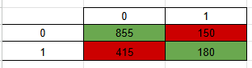
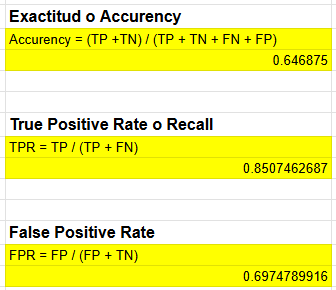
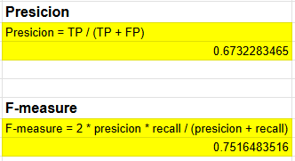

## 2. Árboles de decisión y ganancia de información

**Función `A or (B and C)`.** Armé la tabla de verdad y el árbol de decisión en WEKA (J48), con poda y sin poda. Sin podar (`unpruned = True`, `MinNumObj = 1`) aparece el atributo derivado `B and C`; quitándolo queda el árbol con las variables originales A, B y C.

Reglas de decisión:

```
si A = 1          → clase 1
si no, si B = 0   → clase 0
si no, si C = 0   → clase 0
si no             → clase 1
```

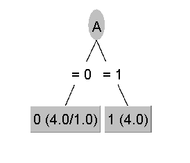
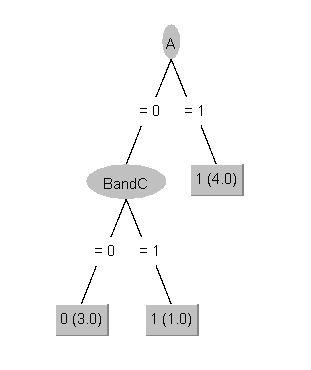
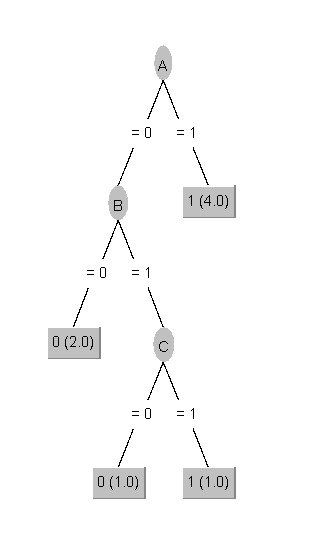

**Ganancia de información** sobre 6 registros con dos atributos (A1, A2) y clase P/N: la entropía inicial es de 1 bit; la ganancia de A1 es de **0,0817** y la de A2 es **0**. A1 aporta algo de información y A2 no contribuye a clasificar.

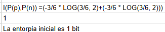
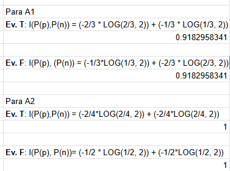
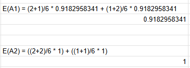
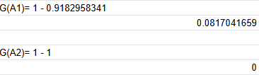

## 3. Reconocimiento de 9 gestos de mano

Cada gesto (`s`, `1`, `2`, `3`, `4`, `5`, `9`, `L`, `a`) está descrito por coordenadas 3D de los marcadores de la mano. Preparé los datos con los filtros `RemoveUseless` y `ReplaceMissingValues`, entrené un árbol J48 y lo probé con dos conjuntos:

| Conjunto de prueba | Instancias | Exactitud |
|---|---|---|
| Test | 1.792 | **99,9 %** |
| Datos externos | 4.500 | **85,1 %** |

Con datos externos el gesto **`a` baja a 48,8 % de recall** (243 de 500 se clasifican como `s`) y el `1` a 79,8 % (82 de 500 van a `s`). Una prueba perfecta no anticipaba esos problemas.

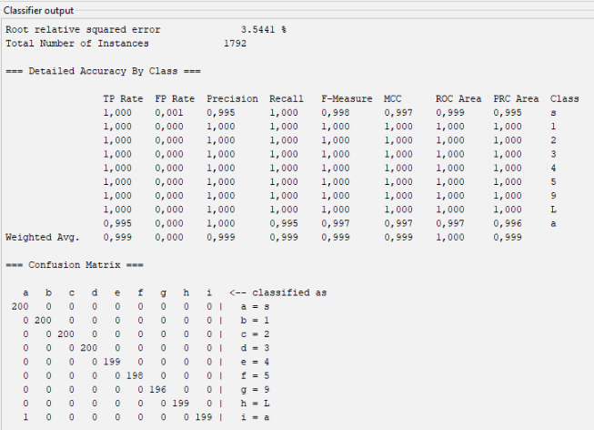
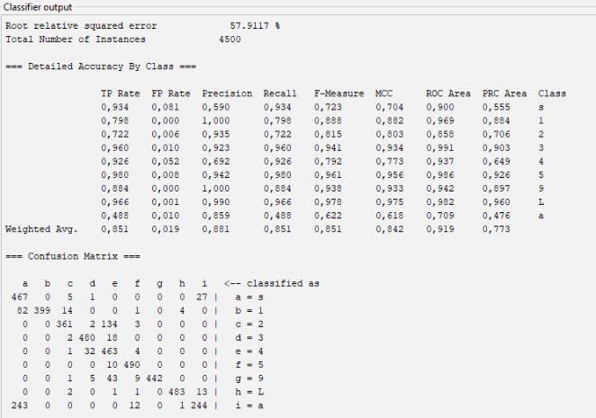

## 4. Segmentación de pacientes con K-means

Con el conjunto de diabetes Pima apliqué `RemoveUseless`, `ReplaceMissingValues` y `Standardize`, para que atributos de escala grande como glucosa o insulina no dominen la distancia euclídea.

Probé tres formas de validar: dataset completo, hold-out 70/30 y validación cruzada de 10 pliegues. El dataset completo es optimista porque evalúa con los mismos datos de entrenamiento; el hold-out es más realista pero depende de la partición; la validación cruzada es la más estable. El SSE baja en conjuntos más chicos solo porque suman menos puntos, así que importa comparar valores relativos entre configuraciones y no absolutos.

| k | SSE |
|---|---|
| 2 | 149,52 |
| 3 | 127,71 |
| 4 | 119,18 |
| 5 | 107,59 |

Con el método del codo elegí **k = 3**: de 2 a 3 clusters la caída es la más pronunciada y después la mejora es marginal.

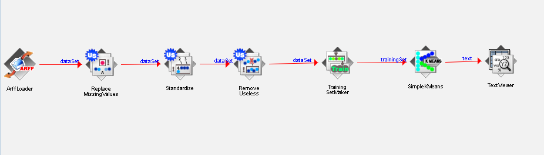
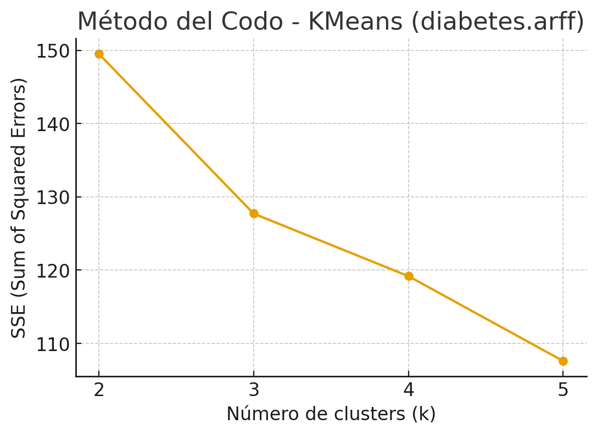
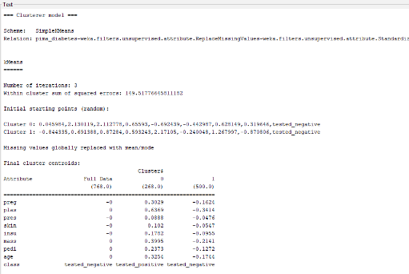
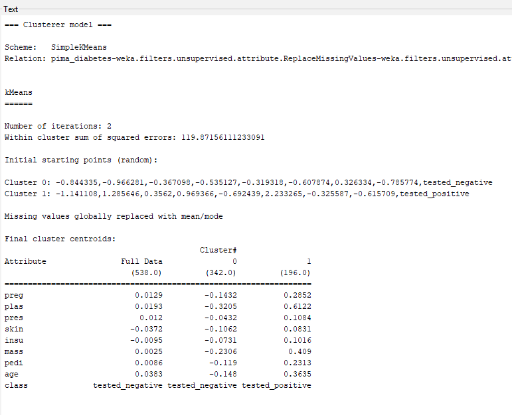
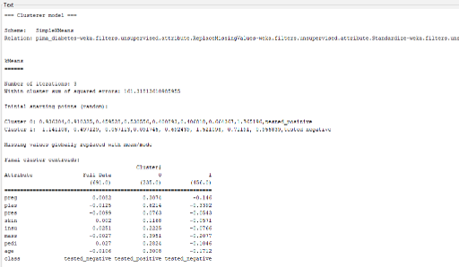

## Contenido

```
capturas/   Resultados y capturas de los experimentos en WEKA
datos/      Dataset público de diabetes (Pima)
```

## Autoría

Trabajo realizado junto con Juana Ruiz Luque.
